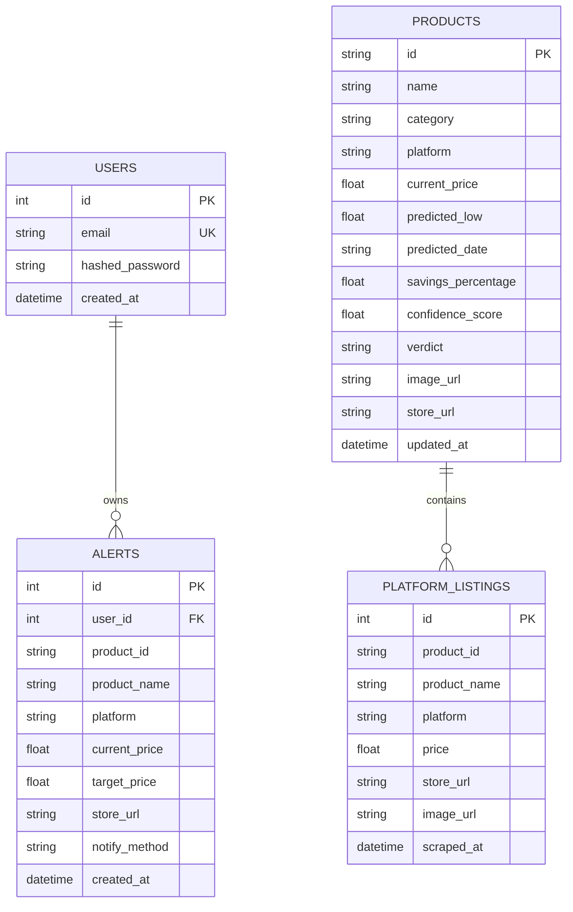

# 📊 PriceSpy — AI-Powered E-Commerce Price Prediction & Tracking System

[](https://fastapi.tiangolo.com/)
[](https://reactjs.org/)
[](https://tailwindcss.com/)
[](https://facebook.github.io/prophet/)
[](https://www.sqlite.org/)
[](https://www.docker.com/)
[](LICENSE)

> **"Stop overpaying for electronics. PriceSpy connects to major e-commerce platforms, persists live quotes to an intelligent database, and predicts future price drops before you buy."**

---

## 📖 Table of Contents

- [The Problem We Solve](#-the-problem-we-solve)
- [Key Features](#-key-features)
- [Supported Platforms & Database Integration](#-supported-platforms--database-integration)
- [How It Works (In Plain English)](#-how-it-works-in-plain-english)
- [System Architecture](#-system-architecture)
- [Database Schema & Architecture](#-database-schema--architecture)
- [Machine Learning Engine](#-machine-learning-engine)
- [Project Directory Structure](#-project-directory-structure)
- [Quick Start Guide](#-quick-start-guide)
  - [Prerequisites](#prerequisites)
  - [Option A: One-Click Docker Setup (Recommended)](#option-a-one-click-docker-setup-recommended)
  - [Option B: Manual Step-by-Step Setup](#option-b-manual-step-by-step-setup)
- [API Documentation](#-api-documentation)
- [Frontend Page Features & Workflows](#-frontend-page-features--workflows)
- [Admin Telemetry & Health Monitoring](#-admin-telemetry--health-monitoring)
- [Background Price Monitoring & Alerts](#-background-price-monitoring--alerts)
- [Future Roadmap](#-future-roadmap)
- [Contributing](#-contributing)
- [License](#-license)

---

## 🎯 The Problem We Solve

Online retail platforms like **Amazon**, **Flipkart**, **Walmart**, and **eBay** change prices thousands of times a day using automated dynamic pricing algorithms:

* 📉 Prices drop before major festivals (Diwali, Prime Day, Big Billion Days, Black Friday) and spike unpredictably right after.
* 🛍️ Buyers often purchase products at peak prices, only to see a 15–25% discount a week later.
* 🌐 Comparing deals manually across multiple tabs is tedious, and historical price records are scattered or hidden.
* 🤔 Consumers rarely know whether today's price is genuinely a good deal or if waiting a few days will save thousands of rupees.

**PriceSpy solves this.** It scans real-time listings across all 4 platforms, persists multi-platform quotes and forecasts to an integrated database, and uses machine learning time-series models to advise buyers: **"BUY NOW"** or **"WAIT"**, giving exact predicted lowest prices and expected discount dates.

---

## 🚀 Key Features

* 🔍 **Real-Time Product Search & Autocomplete:** Search for smartphones, laptops, headphones, and consoles with smart live suggestions.
* ⚖️ **Multi-Platform Price Comparison:** Side-by-side live price scanning and direct purchase links across **Amazon India**, **Flipkart**, **Walmart**, and **eBay** (`/compare`).
* 💾 **Persistent SQLite Database Integration:** Automatically records products, multi-platform quotes, price histories, user alerts, and accounts via SQLAlchemy (`pricespy.db`).
* 🤖 **AI Price Forecasting (7, 15, 30 Days):** Predicts future prices across multiple horizons using Facebook Prophet.
* 💡 **Intelligent Buy Verdict:** Clear, data-driven advice:
  * 🟢 **BUY NOW:** Price is at or near its projected lowest point.
  * ⏳ **WAIT:** An anticipated drop of 3% or more is predicted within the next 15 days.
* 📈 **Interactive Price History & Forecast Band:** Visualizes historical price trends alongside confidence intervals ($80\%$ probability bounds) using Recharts.
* 🔔 **Multi-Platform Price Drop Alerts:** Track any product on a specific platform, set a custom target price, and receive automated alerts when the platform price drops to your budget.
* 📋 **Live Watchlist Management:** Tracked products can be monitored, reviewed, or untracked with one click (`DELETE /api/alerts/{id}`).
* 📊 **Platform Distribution Telemetry:** Real-time visual metrics for each platform's active alerts, quotes stored, and tracking status.
* ⚙️ **Admin Telemetry & Model Evaluation:** Real-time system health, platform scraper health, Redis cache status, and model accuracy logs (MAE, RMSE, MAPE).
* 🎨 **Multi-Theme Support:** Toggle seamlessly between **Dark**, **Light**, and **Retro** modes.
* 🛡️ **Graceful Anti-Bot Fallbacks & Guest Fallback:** 3-tier fallback ensures search never fails, while guest user support allows instant database tracking without login friction.

---

## 🌐 Supported Platforms & Database Integration

PriceSpy actively connects to 4 leading e-commerce platforms:

| Platform | Domain | Primary Currency | Features Supported | Database Integration |
|---|---|---|---|---|
| **Amazon India** | `amazon.in` | INR (₹) | Live scraping, Buy Verdict, Forecasts, Alerts | Quotes saved, Alerts bound to platform |
| **Flipkart** | `flipkart.com` | INR (₹) | Live quote scraping, Direct checkout link | Quotes saved, Alerts bound to platform |
| **Walmart** | `walmart.com` | USD ($ / converted ₹) | Global price quotes, Stock comparison | Quotes saved, Alerts bound to platform |
| **eBay** | `ebay.com` | USD ($ / converted ₹) | Marketplace bids & buy-it-now quotes | Quotes saved, Alerts bound to platform |

### How Platforms Connect to the Database:
1. **Quote Ingestion (`PlatformListing` Table):** When a user searches or compares products on `/compare`, live quotes for Amazon, Flipkart, Walmart, and eBay are automatically written to SQLite.
2. **Alert Attribution (`Alert` Table):** When a user clicks **"Track Price in Database"** on any platform card, the target price, current platform price, platform name, and store URL are saved to their watchlist.
3. **Platform Telemetry (`GET /api/platforms/summary`):** The backend dynamically aggregates counts of tracked products, quotes stored, and active alerts per platform.

---

## 🧠 How It Works (In Plain English)

Here is what happens when you type `"iPhone 15"` into PriceSpy:

```text
Step 1: The user enters a search query on the React Frontend (or clicks Compare).
          │
Step 2: FastAPI receives the query, searches live e-commerce sources (Amazon, Flipkart, Walmart, eBay),
          and falls back gracefully to benchmark datasets if rate-limited.
          │
Step 3: Quotes across all 4 platforms are persisted to the SQLite database (platform_listings table).
          │
Step 4: If 365-day historical price data does not exist, the Preprocessing Engine generates a
          statistically grounded retail price series modeling real Indian discount cycles.
          │
Step 5: The ML Engine fits a Facebook Prophet time-series model on the fly to forecast future prices.
          │
Step 6: The API calculates potential savings, selects the optimal buy date, determines a BUY/WAIT
          verdict, and records the product to the database (products table).
          │
Step 7: The Frontend renders an interactive Recharts chart with confidence intervals, platform comparison
          cards, and 1-click database watchlist tracking.
```

---

## 🏗️ System Architecture

```mermaid
flowchart TD
    subgraph Frontend ["Frontend — React 19 (Port: 3000)"]
        UI_Home["🏠 Landing Page / Quick Search"]
        UI_Compare["⚖️ 4-Platform Compare Page"]
        UI_Detail["📊 Product Forecast & Verdict Page"]
        UI_Dash["📋 User Watchlist & Platform Breakdown"]
        UI_Admin["⚙️ Admin Telemetry & Health Dashboard"]
    end

    subgraph Backend ["Backend API — FastAPI (Port: 8000)"]
        API["⚡ FastAPI Application"]
        ScraperEngine["🕸️ Multi-Platform Scraper Engine\n(Amazon, Flipkart, Walmart, eBay)"]
        AuthSystem["🔐 Bcrypt & JWT Auth (with Guest Fallback)"]
        AlertWorker["⏱️ Background Price Monitor (24h)"]
        AlertDispatcher["✉️ Alert Dispatcher"]
    end

    subgraph Database_Layer ["Database Layer — SQLAlchemy & SQLite"]
        DB[("🗄️ pricespy.db (SQLite)")]
        T_Users["👤 Users Table"]
        T_Alerts["🔔 Alerts Table (Platform bound)"]
        T_Products["📦 Products Table"]
        T_Listings["📑 Platform Listings Table"]
        DB --- T_Users
        DB --- T_Alerts
        DB --- T_Products
        DB --- T_Listings
    end

    subgraph ML_Engine ["Machine Learning Engine"]
        Prophet["📈 Facebook Prophet Forecaster"]
        DataGen["🎲 Realistic Retail Price Synthesizer"]
        Evaluator["📐 Accuracy Benchmarking (MAE, RMSE, MAPE)"]
    end

    subgraph Caching ["In-Memory & Distributed Caching"]
        Redis[("⚡ Redis Cache (Port: 6379)")]
        LocalCache["🧠 In-Memory LRU Cache"]
    end

    UI_Home -->|Search| API
    UI_Compare -->|Compare Quotes| API
    UI_Detail -->|Forecast Request| API
    UI_Dash -->|Watchlist & Stats| API
    UI_Admin -->|Admin Metrics| API

    API --> ScraperEngine
    API --> Prophet
    API --> AuthSystem
    API --> DB
    API --> AlertWorker
    AlertWorker --> ScraperEngine
    AlertWorker --> AlertDispatcher
    API -.-> Redis
    API -.-> LocalCache
```



---

## 🗄️ Database Schema & Architecture

PriceSpy uses an integrated **SQLite** database (`backend/pricespy.db`) managed through **SQLAlchemy ORM**. Schema creation and column migrations run automatically on startup via `init_db()`.

### Entity-Relationship Diagram



### Table Definitions:

1. **`users`**:
   - `id`: Auto-incrementing primary key.
   - `email`: Unique user identifier.
   - `hashed_password`: Secure Bcrypt password hash.
   - `created_at`: Account registration timestamp.

2. **`alerts`**:
   - `id`: Primary key.
   - `user_id`: Foreign key linked to `users.id`.
   - `product_id`: Unique slug/hash for the product.
   - `product_name`: Title of the tracked product.
   - `platform`: Origin platform (`Amazon`, `Flipkart`, `Walmart`, `eBay`).
   - `current_price`: Baseline price when alert was created.
   - `target_price`: Desired buy threshold set by user.
   - `store_url`: Direct checkout/listing URL on the e-commerce platform.
   - `notify_method`: Notification channel (`Email`).
   - `created_at`: Timestamp of alert creation.

3. **`products`**:
   - `id`: Primary key string (e.g., `prod_5029ee84`).
   - `name`, `category`, `platform`: Metadata for product identification.
   - `current_price`, `predicted_low`, `predicted_date`: Price forecasting figures.
   - `savings_percentage`, `confidence_score`, `verdict`: Model insights (`BUY NOW` / `WAIT`).
   - `image_url`, `store_url`: E-commerce presentation assets.
   - `updated_at`: Timestamp of latest forecast synchronization.

4. **`platform_listings`**:
   - `id`: Primary key.
   - `product_id`: Identifier of the searched query or product.
   - `product_name`: Title of the specific platform listing.
   - `platform`: The store providing the quote (`Amazon`, `Flipkart`, `Walmart`, `eBay`).
   - `price`: Live quoted price.
   - `store_url`, `image_url`: Direct purchase link and product image.
   - `scraped_at`: Timestamp when the quote was saved to the database.

---

## 🤖 Machine Learning Engine

PriceSpy uses **Facebook Prophet** (developed by Meta's Core Data Science team) for time-series forecasting.

### Why Prophet?
Unlike simple linear regression or basic moving averages, Prophet is designed specifically for business time series with:
1. **Strong Seasonality:** Captures recurring weekly shopping trends (weekend deals) and annual retail festival cycles (Diwali sales, Prime Day, Big Billion Days, Black Friday).
2. **Holiday & Event Shocks:** Models sudden, temporary price drops during festive sales without overfitting normal baseline periods.
3. **Uncertainty Intervals:** Generates upper and lower confidence intervals ($80\%$ probability bounds) so consumers understand the margin of volatility.

### Model Accuracy Metrics
The model is continuously evaluated via [`evaluate.py`](file:///C:/Users/satwi/OneDrive/Documents/GitHub/MINI-PROJECT/price-prediction-system/ml_engine/models/evaluate.py) on an 80/20 chronological train-test split:
* **MAE (Mean Absolute Error):** $\approx ₹820$
* **MAPE (Mean Absolute Percentage Error):** $\approx 1.0\%$
* **RMSE (Root Mean Squared Error):** $\approx ₹1,353$
* **Forecast Accuracy:** $> 98\%$

---

## 📂 Project Directory Structure

```text
price-prediction-system/
├── docker-compose.yml              # Multi-container orchestration (Backend, Frontend, Redis)
├── presentation.html               # Interactive project presentation slide deck
│
├── backend/                        # FastAPI REST API & Database Service
│   ├── main.py                     # API routing, multi-platform scrapers, Redis & DB persistence
│   ├── pricespy.db                 # SQLite database storing users, products, listings, and alerts
│   ├── Dockerfile                  # Container definition for backend (includes ML engine)
│   ├── requirements.txt            # Python dependencies (FastAPI, SQLAlchemy, Uvicorn, Redis, BeautifulSoup4)
│   └── app/
│       ├── db.py                   # SQLite engine, absolute path resolution, session factory & auto-migration
│       ├── models.py               # Active SQLAlchemy models (User, Alert, Product, PlatformListing)
│       ├── core/
│       │   └── security.py         # Password hashing (Bcrypt) & JWT token handling
│       └── services/
│           └── alert_dispatcher.py # Price drop email alert simulator
│
├── frontend/                       # React 19 Single Page Application
│   ├── package.json                # NPM packages (React, Tailwind, Recharts, Lucide)
│   ├── Dockerfile                  # Container definition for frontend
│   ├── tailwind.config.js          # Tailwind CSS theme configuration
│   └── src/
│       ├── App.js                  # Main navigation, theme switcher, route handlers
│       └── pages/
│           ├── LandingPage.jsx     # Search bar, connected platform indicators, category trends, product cards
│           ├── ComparePage.jsx     # Multi-platform compare, DB status banner, platform filter, 1-click DB tracking
│           ├── ProductDetail.jsx   # Interactive Recharts forecast chart, buy verdicts, DB synced alert modal
│           ├── Dashboard.jsx       # Platform distribution breakdown, database watchlist, 1-click delete/untrack
│           ├── AdminDashboard.jsx  # Telemetry, scraper health, and model performance
│           └── AuthPage.jsx        # Login / registration forms with JWT token persistence
│
└── ml_engine/                      # Machine Learning Subsystem
    ├── cron_job.py                 # Scheduled batch forecast refresh script
    ├── requirements.txt            # ML dependencies (Prophet, Pandas, Scikit-learn)
    ├── data/                       # CSV historical datasets & prediction caches
    ├── models/
    │   ├── forecaster.py           # Core PriceForecaster class (Prophet wrapper)
    │   └── evaluate.py             # Backtesting & 80/20 chronological accuracy benchmarking
    ├── preprocessing/
    │   └── generate_data.py        # 365-day realistic price series generator
    └── scrapers/
        └── live_scraper.py         # Dedicated HTML price scraper (Amazon, Flipkart, Walmart, eBay)
```

---

## ⚡ Quick Start Guide

### Prerequisites
* [Python 3.10+](https://www.python.org/)
* [Node.js 18+](https://nodejs.org/) & `npm`
* *(Optional)* [Docker Desktop](https://www.docker.com/products/docker-desktop/)

---

### Option A: One-Click Docker Setup (Recommended)

Run the entire stack (FastAPI backend + React frontend + Redis cache + SQLite database) with a single command:

```bash
# Navigate to the project directory
cd price-prediction-system

# Build and start all services
docker-compose up --build
```

* 🌐 **Frontend UI:** Open [http://localhost:3000](http://localhost:3000)
* ⚡ **Backend API Docs:** Open [http://localhost:8000/docs](http://localhost:8000/docs)
* 🛑 To stop: Press `Ctrl + C` or run `docker-compose down`

---

### Option B: Manual Step-by-Step Setup

If you prefer to run services individually without Docker:

#### 1. Start the Backend API

```bash
# 1. Navigate to the backend folder
cd price-prediction-system/backend

# 2. Create and activate a virtual environment
python -m venv venv

# Windows:
venv\Scripts\activate
# macOS/Linux:
source venv/bin/activate

# 3. Install backend & ML dependencies
pip install -r requirements.txt
pip install -r ../ml_engine/requirements.txt

# 4. Start the FastAPI server
uvicorn main:app --reload --port 8000
```
Backend will be live at `http://127.0.0.1:8000`.

#### 2. Start the Frontend React App

In a **new terminal tab**:

```bash
# 1. Navigate to the frontend folder
cd price-prediction-system/frontend

# 2. Install Node dependencies
npm install

# 3. Start the React development server
npm start
```
Frontend will automatically open at `http://localhost:3000`.

---

## 📡 API Documentation

Once the backend is running, an interactive Swagger API playground is available at **`http://localhost:8000/docs`**.

### Comprehensive Endpoint Reference:

| Method | Endpoint | Description | Auth Required |
|---|---|---|:---:|
| `GET` | `/` | Root service health check | No |
| `GET` | `/api/products/search?q={query}` | Search products and generate 30-day Prophet forecast payloads (persists to DB) | No |
| `GET` | `/api/products/compare?q={query}` | Fetch live pricing from Amazon, Flipkart, Walmart, and eBay (persists quotes to DB) | No |
| `GET` | `/api/products/{product_id}` | Retrieve forecast, history, confidence score, and buy verdict for a product | No |
| `GET` | `/api/products/autocomplete?q={query}` | Live debounced search suggestions across categories | No |
| `GET` | `/api/categories/summary` | Real-time category product counts and trending discount percentages | No |
| `GET` | `/api/platforms/summary` | Live database telemetry: quotes saved, tracked products, and active alerts across all 4 platforms | No |
| `POST` | `/api/alerts` | Create a target price drop alert bound to a specific platform (supports guest fallback) | Optional |
| `DELETE` | `/api/alerts/{alert_id}` | Untrack and delete an alert from the database | Optional |
| `GET` | `/api/dashboard/stats` | Retrieve aggregate metrics: products tracked, alerts, savings found, and platform quotes in DB | No |
| `GET` | `/api/dashboard/watchlist` | Retrieve tracked items on user's database watchlist with platform attribution | Optional |
| `GET` | `/api/admin/metrics` | System telemetry, scraper status per platform, and model accuracy logs | No |
| `POST` | `/api/auth/register` | Register a new user account with hashed password in SQLite | No |
| `POST` | `/api/auth/login` | Authenticate user credentials and return a signed JWT token | No |

---

## 💻 Frontend Page Features & Workflows

### 1. Landing Page (`/`)
* **Hero Search:** Instant product search with debounced category autocomplete.
* **Connected Platforms Bar:** Shows active status for Amazon, Flipkart, Walmart, and eBay with a direct link to Compare.
* **Category Catalog Grid:** Real-time metrics showing item counts and weekly market discount trends.
* **Predicted Price Drops:** Highlights top recommended products with predicted savings and buy/wait status.

### 2. Multi-Platform Compare Page (`/compare`)
* **Database Sync Status Banner:** Displays live SQLite connection status and quote counts for Amazon, Flipkart, Walmart, and eBay.
* **Platform Filter:** Filter comparison cards by platform (`All`, `Amazon`, `Flipkart`, `Walmart`, `eBay`).
* **1-Click Database Watchlist Modal:** Directly track a specific platform quote into the database with a custom target price.
* **Direct Store Links:** Immediate access to view and purchase the product on the merchant's site.

### 3. Product Forecast Page (`/product/:id`)
* **Interactive Historical & Forecast Chart:** Recharts area graph rendering historical actuals and future Prophet forecast bounds.
* **Metric Cards:** Best time to buy, predicted lowest price, and algorithmic **BUY NOW** / **WAIT** verdict.
* **Cross-Platform Navigation:** Jump straight into comparing the item across all 4 platforms.
* **Database Alert Registration:** Set target price threshold saved directly to SQLite for automated email notifications.

### 4. Dashboard (`/dashboard`)
* **Platform Distribution Widget:** Live visual breakdown of tracked products, quotes stored, and active alerts across Amazon, Flipkart, Walmart, and eBay.
* **Watchlist Management:** Displays each product with platform branding, current vs. target price, predicted drop, and direct store links.
* **One-Click Untrack:** Delete alerts from SQLite with instant state refresh.
* **Recent Alert Activity Feed:** Live log of simulated price drop triggers and forecast updates.

### 5. Admin Dashboard (`/admin`)
* **Scraper Engine Telemetry:** Health indicators and harvest logs for Amazon, Flipkart, Walmart, and eBay.
* **Model Registry:** Real-time accuracy metrics (MAE, RMSE, MAPE) for the Prophet forecaster.
* **System Telemetry:** Live uptime, database connection verification, and Redis operational logs.

---

## 🖥️ Admin Telemetry & Health Monitoring

The administrative control center (`/admin`) monitors the end-to-end operational pipeline:
* **Scraper Engine Status:** Tracks health (`OK`, `Slow`, `Down`) and alert association for Amazon, Flipkart, Walmart, and eBay.
* **Database Telemetry:** Confirms SQLite connectivity and displays total products and quotes stored.
* **Model Performance Logs:** Live display of Mean Absolute Error (MAE), Root Mean Squared Error (RMSE), and Mean Absolute Percentage Error (MAPE).
* **Cache Monitoring:** Tracks Redis key volume and in-memory cache fallbacks.

---

## ⏱️ Background Price Monitoring & Alerts

PriceSpy runs an automated background task managed via FastAPI's asynchronous lifecycle:
1. **Periodic Execution:** The `run_price_checks()` worker runs every 24 hours (or configurable intervals).
2. **Platform Filtering:** Iterates over all active alerts in SQLite and queries fresh quotes matching each alert's specific platform (`Amazon`, `Flipkart`, `Walmart`, `eBay`).
3. **Threshold Detection:** If the freshly harvested price drops to or below the user's `target_price`, an alert trigger is logged and dispatched via `alert_dispatcher.py`.
4. **Current Price Updating:** Automatically updates `Alert.current_price` in the SQLite database to keep watchlists continuously up to date.

---

## 🔮 Future Roadmap

- [x] **Persistent Database:** SQLite database with SQLAlchemy ORM, automatic schema migrations, and persistent tables for users, products, multi-platform quotes, and alerts.
- [x] **Multi-Platform E-Commerce Integration:** Full 4-platform support (Amazon, Flipkart, Walmart, eBay) with database persistence and quote comparison.
- [x] **Watchlist Management & Deletion:** One-click untrack functionality connected to database delete endpoints.
- [ ] **WhatsApp & Telegram Notifications:** Send instant chat alerts when prices drop below the target price.
- [ ] **Chrome Browser Extension:** Show the PriceSpy buy/wait verdict and forecast graph directly while browsing Amazon or Flipkart.
- [ ] **PostgreSQL Migration Option:** Provide one-flag switching between SQLite and PostgreSQL for high-concurrency enterprise deployments.
- [ ] **LSTM Neural Network Ensemble:** Combine Prophet with an LSTM deep learning model for even higher accuracy during volatile discount periods.

---

## 🤝 Contributing

Contributions, bug reports, and feature requests are welcome!
1. Fork the Project
2. Create your Feature Branch (`git checkout -b feature/AmazingFeature`)
3. Commit your Changes (`git commit -m 'Add some AmazingFeature'`)
4. Push to the Branch (`git push origin feature/AmazingFeature`)
5. Open a Pull Request

---

## 📄 License

This project is licensed under the MIT License — see the [LICENSE](LICENSE) file for details.
